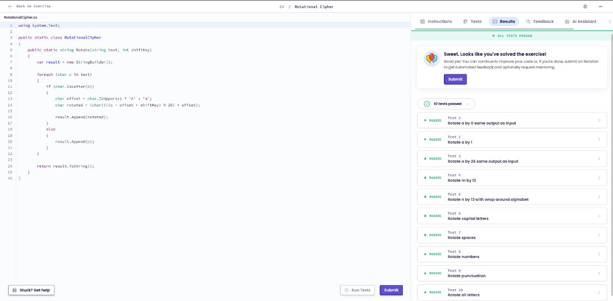
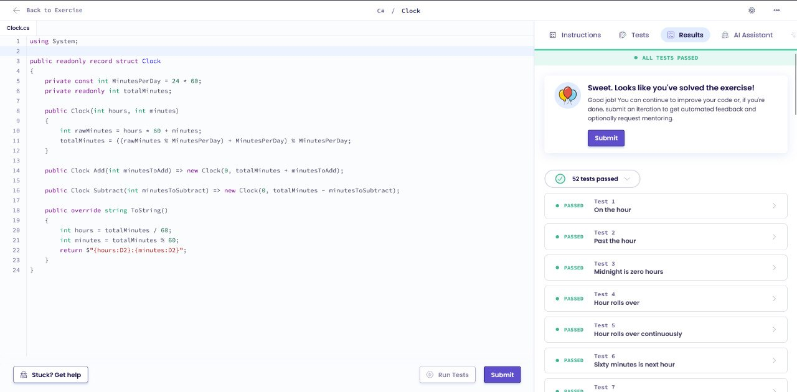
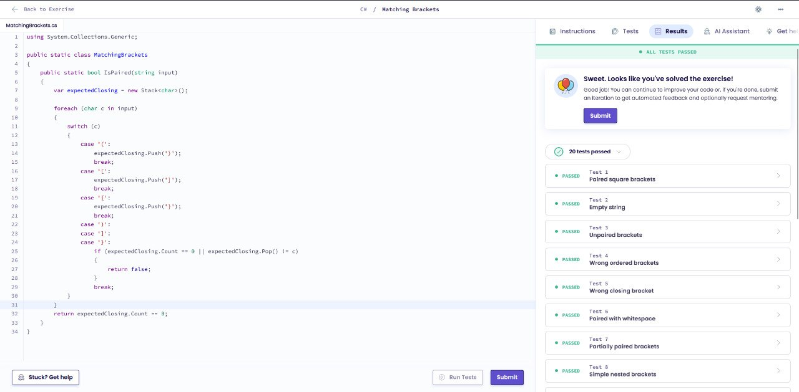
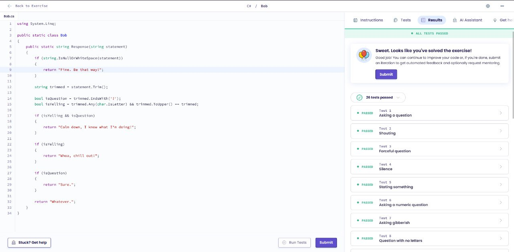
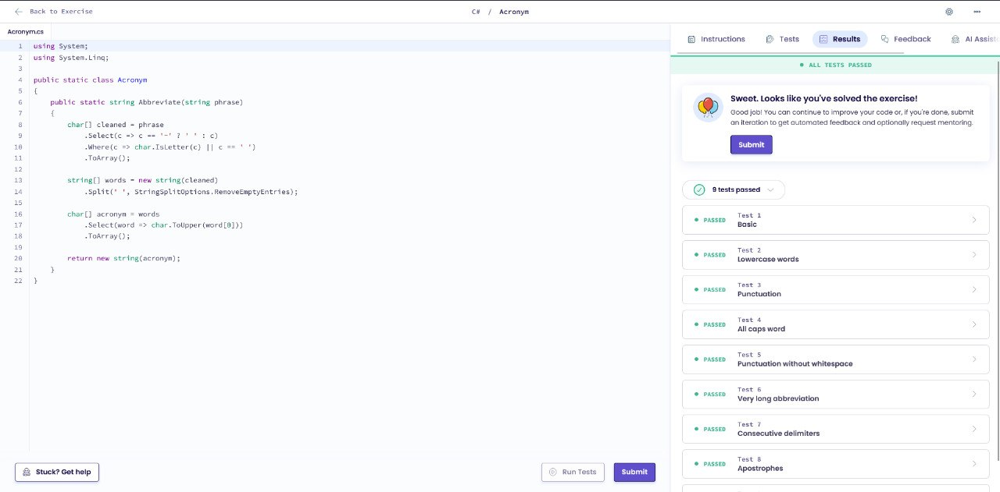
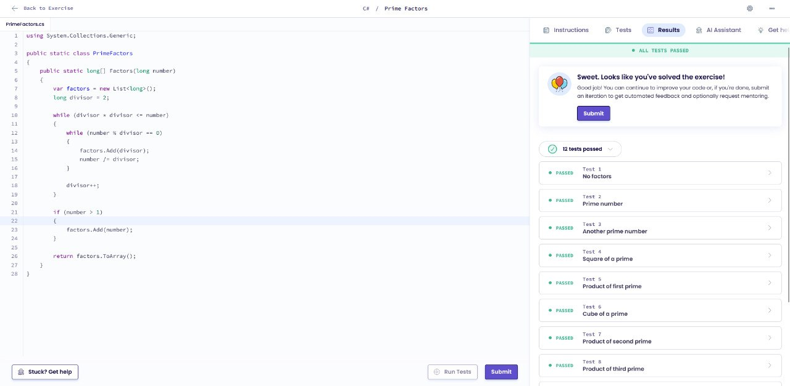
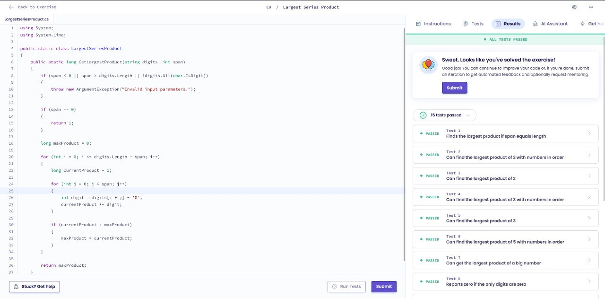
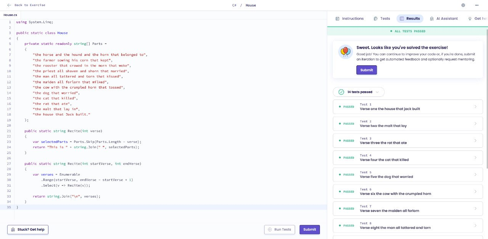
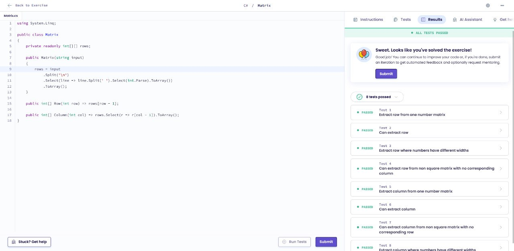
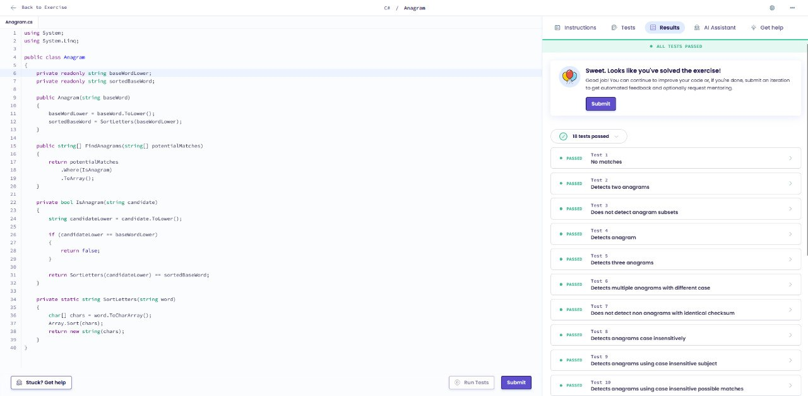

# Самостійна робота #1 (C# / Exercism)
 
**Технології:** C#, .NET 10.0

**Рівень складності:** Medium

---

## Завдання 1: Rotational Cipher
- **Умова на Exercism:** [Rotational Cipher](https://exercism.org/tracks/csharp/exercises/rotational-cipher)
- **Код:** [`Task1_RotationalCipher/RotationalCipher.cs`](./Task1_RotationalCipher/RotationalCipher.cs)

---

## Завдання 2: Clock
- **Умова на Exercism:** [Clock](https://exercism.org/tracks/csharp/exercises/clock)
- **Код:** [`Task2_Clock/Clock.cs`](./Task2_Clock/Clock.cs)

---

## Завдання 3: Matching Brackets
- **Умова на Exercism:** [Matching Brackets](https://exercism.org/tracks/csharp/exercises/matching-brackets)
- **Код:** [`Task3_MatchingBrackets/MatchingBrackets.cs`](./Task3_MatchingBrackets/MatchingBrackets.cs)

---

## Завдання 4: Bob
- **Умова на Exercism:** [Bob](https://exercism.org/tracks/csharp/exercises/bob)
- **Код:** [`Task4_Bob/Bob.cs`](./Task4_Bob/Bob.cs)

---

## Завдання 5: Acronym
- **Умова на Exercism:** [Acronym](https://exercism.org/tracks/csharp/exercises/acronym)
- **Код:** [`Task5_Acronym/Acronym.cs`](./Task5_Acronym/Acronym.cs)

---

## Завдання 6: Prime Factors
- **Умова на Exercism:** [Prime Factors](https://exercism.org/tracks/csharp/exercises/prime-factors)
- **Код:** [`Task6_PrimeFactors/PrimeFactors.cs`](./Task6_PrimeFactors/PrimeFactors.cs)

---

## Завдання 7: Largest Series Product
- **Умова на Exercism:** [Largest Series Product](https://exercism.org/tracks/csharp/exercises/largest-series-product)
- **Код:** [`Task7_LargestSeriesProduct/LargestSeriesProduct.cs`](./Task7_LargestSeriesProduct/LargestSeriesProduct.cs)

---

## Завдання 8: House
- **Умова на Exercism:** [House](https://exercism.org/tracks/csharp/exercises/house)
- **Код:** [`Task8_House/House.cs`](./Task8_House/House.cs)

---

## Завдання 9: Matrix
- **Умова на Exercism:** [Matrix](https://exercism.org/tracks/csharp/exercises/matrix)
- **Код:** [`Task9_Matrix/Matrix.cs`](./Task9_Matrix/Matrix.cs)

---

## Завдання 10: Anagram
- **Умова на Exercism:** [Anagram](https://exercism.org/tracks/csharp/exercises/anagram)
- **Код:** [`Task10_Anagram/Anagram.cs`](./Task10_Anagram/Anagram.cs)

